<picture><source media="(max-width: 640px) and (prefers-color-scheme: dark)" srcset=".github/readme/header-phone-dark.svg"><source media="(max-width: 640px)" srcset=".github/readme/header-phone-light.svg"><source media="(prefers-color-scheme: dark)" srcset=".github/readme/header-dark.svg"></picture>

StockSaathi gives every student a virtual ₹1,00,000 portfolio priced off real NSE and BSE quotes,
then coaches the behaviour behind each trade rather than handing out tips.
It is live at **[stocksaathi.co.in](https://stocksaathi.co.in)**.

## What it does

| | |
|---|---|
| **Real market, virtual money** | Live quotes, OHLC charts, fundamentals, limit orders and mutual funds. Real instruments and real volatility, with no money at risk. |
| **Behaviour coach** | Detectors run on every trade (panic-selling, FOMO, anchoring, concentration, overtrading and more), and a coach grounded in historical recovery data explains what just happened, using the student's own numbers. |
| **Time Travel** | Market crashes replayed day by day, from 1992 to 2023, so students can see what holding would have done compared with selling in a panic. |
| **Report card** | A grade for decision quality, not returns, updated after every decision. |

StockSaathi gives no buy or sell recommendations, runs no returns leaderboard and places no real orders.
It is an educational simulator, not a broker or an adviser, and is not affiliated with SEBI, NSE or BSE.

## How it's built

<picture><source media="(max-width: 640px) and (prefers-color-scheme: dark)" srcset=".github/readme/architecture-phone-dark.svg"><source media="(max-width: 640px)" srcset=".github/readme/architecture-phone-light.svg"><source media="(prefers-color-scheme: dark)" srcset=".github/readme/architecture-dark.svg"></picture>

| Layer | What it uses |
|---|---|
| Front end | Vanilla ES modules, a hash router and a custom SVG charting engine. An installable PWA with no framework and no build step. |
| API | Python serverless functions on Vercel, plus edge functions for the paths where latency matters. |
| Data | Postgres with row-level security throughout. Cross-user reads go through RPCs. |
| Market data | A cache-first quote layer with a multi-provider fallback chain. |
| Reliability | A Cloudflare Worker front door that fails over to a hot mirror on 5xx, timeouts or network errors. |

## Try it

There is nothing to install. Open [stocksaathi.co.in](https://stocksaathi.co.in) in a browser, or add it to your home screen as an app.

## About this repository

This repository is the public home of StockSaathi. The application source lives in a separate repository.

Built by [Ali Arbab](https://github.com/thealiarbab), Founder of StockSaathi. All rights reserved.
